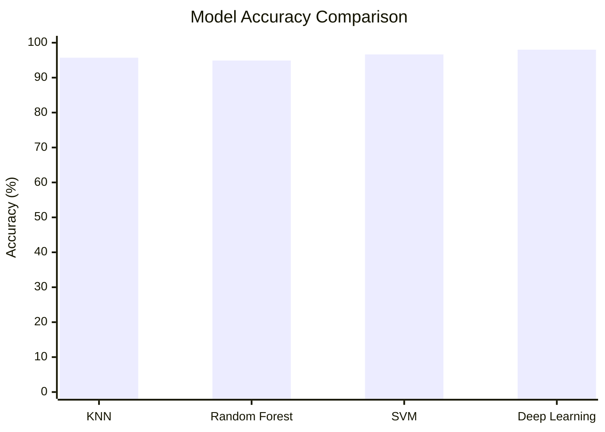

# Badminton-Stroke-Classifier

A wearable IMU device was developed to recognize badminton strokes, both with and without shuttle contact. A dataset was created from recordings of five badminton players with varying skill levels and playing styles. For power efficiency, data is transmitted to a server via Wi-Fi for processing. Various classical machine learning techniques and deep learning architectures were investigated to identify the most appropriate algorithm for this application. The results demonstrate that this approach offers a promising foundation for developing fast, simple, and accurate algorithms for sports science studies.

## 📊 Dataset Format

### Dataset overview

| Property | Value |
| --- | --- |
| Name | `Badminton_Stroke_Dataset` |
| Version | v2.0 |
| Created | 2023 |
| Total samples | 9,784 |
| Subjects | 5 badminton players |
| Stroke types | Clear, Slice, Drive, and Smash |
| Contact categories | Real and fake shuttle contact |

### Sensor and preprocessing

| Property | Value |
| --- | --- |
| Sensor | MPU6050 |
| Sensor placement | Racket handle |
| Sampling rate | 100 Hz |
| Window size | 100 samples |
| Accelerometer units | m/s² |
| Gyroscope units | deg/s |
| Filter | Digital low-pass filter |
| Cutoff frequency | 260 Hz |

### Sample structure

| Field | Description |
| --- | --- |
| `sample_id` | Unique identifier for the sample |
| `stroke_type` | Stroke and contact category, such as `Clear_real` or `Smash_fake` |
| `label` | Numeric class label |
| IMU data sequences | Six 100-sample sequences: `AccX`, `AccY`, `AccZ`, `GyX`, `GyY`, `GyZ` |
| Extracted features | Statistical, correlation, frequency, and information-theoretic features derived from the IMU sequences |

### Extracted feature groups

| Feature group | Included measures |
| --- | --- |
| Statistical | Maximum, minimum, mean, RMS, MAD, median, standard deviation, variance, skewness, and kurtosis |
| Cross-axis | Covariance and correlation between accelerometer and gyroscope axes |
| Signal characteristics | Signal magnitude area, mutual information, crest factor, impulse ratio, energy, and entropy |

## 📈 Model Results

All models were evaluated using the same 9,784-sample dataset split: 7,338 training samples and 2,446 test samples (25% test size). The classical machine learning models use 122 extracted features, while the deep learning model uses six raw IMU channels.

### Classical machine learning

| Model | Main configuration | Test accuracy |
| --- | --- | ---: |
| KNN | 5 neighbors, uniform weights, Euclidean distance, StandardScaler, 30 PCA components | 95.71% |
| Random Forest | 100 estimators, Gini criterion, StandardScaler, 30 PCA components | 94.89% |
| SVM | RBF kernel, `C=1`, `gamma=scale`, StandardScaler, 30 PCA components | **96.65%** |

### Deep learning

| Model | Main configuration | Test accuracy |
| --- | --- | ---: |
| StrokeClassifier | Two convolutional layers, batch normalization, dropout, two fully connected layers, 805,592 parameters | **98.00%** |

The deep learning model achieved the highest reported test accuracy, followed by the SVM. The deep learning training run stopped early at epoch 73 and reached 98% validation accuracy, with a 1.00 training accuracy.

### Accuracy comparison

### Deep learning confusion matrices

The following confusion matrices use class IDs `0` through `7`. Rows represent the actual class, and columns represent the predicted class.

#### Training data

| Actual \ Predicted | 0 | 1 | 2 | 3 | 4 | 5 | 6 | 7 |
| --- | ---: | ---: | ---: | ---: | ---: | ---: | ---: | ---: |
| 0 | 880 | 0 | 0 | 2 | 0 | 0 | 0 | 0 |
| 1 | 0 | 867 | 0 | 0 | 0 | 0 | 0 | 0 |
| 2 | 0 | 0 | 896 | 0 | 0 | 0 | 0 | 0 |
| 3 | 0 | 0 | 0 | 873 | 0 | 0 | 0 | 0 |
| 4 | 0 | 0 | 0 | 0 | 888 | 0 | 0 | 0 |
| 5 | 0 | 0 | 0 | 0 | 0 | 976 | 0 | 0 |
| 6 | 0 | 0 | 0 | 0 | 0 | 0 | 995 | 0 |
| 7 | 0 | 0 | 0 | 0 | 0 | 0 | 0 | 961 |

#### Validation data

| Actual \ Predicted | 0 | 1 | 2 | 3 | 4 | 5 | 6 | 7 |
| --- | ---: | ---: | ---: | ---: | ---: | ---: | ---: | ---: |
| 0 | 282 | 0 | 0 | 3 | 0 | 0 | 0 | 0 |
| 1 | 0 | 295 | 0 | 0 | 0 | 0 | 0 | 0 |
| 2 | 0 | 0 | 292 | 0 | 0 | 0 | 1 | 0 |
| 3 | 0 | 0 | 0 | 298 | 0 | 0 | 0 | 0 |
| 4 | 0 | 0 | 0 | 0 | 283 | 0 | 3 | 17 |
| 5 | 0 | 0 | 1 | 0 | 0 | 337 | 2 | 1 |
| 6 | 0 | 0 | 3 | 0 | 1 | 1 | 302 | 2 |
| 7 | 0 | 0 | 0 | 0 | 13 | 0 | 2 | 307 |

### Best classical ML confusion matrix

The SVM achieved the highest classical machine learning accuracy at 96.65%. The following confusion matrix shows its performance on the test data.

| Actual \ Predicted | 1 | 2 | 3 | 4 | 5 | 6 | 7 | 8 |
| --- | ---: | ---: | ---: | ---: | ---: | ---: | ---: | ---: |
| 1 | 314 | 0 | 0 | 2 | 0 | 0 | 0 | 0 |
| 2 | 0 | 300 | 0 | 0 | 0 | 0 | 0 | 0 |
| 3 | 0 | 0 | 302 | 0 | 0 | 0 | 0 | 0 |
| 4 | 4 | 0 | 0 | 275 | 0 | 0 | 0 | 0 |
| 5 | 0 | 0 | 0 | 0 | 264 | 0 | 7 | 25 |
| 6 | 1 | 0 | 0 | 0 | 1 | 312 | 1 | 0 |
| 7 | 0 | 1 | 0 | 0 | 3 | 4 | 327 | 1 |
| 8 | 0 | 0 | 0 | 0 | 30 | 0 | 2 | 270 |

**Related Project**: [IMU-Badminton-Data-Collection-System](https://github.com/PhusNguyen/IMU-Badminton-Data-Collection-System)
