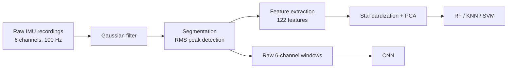
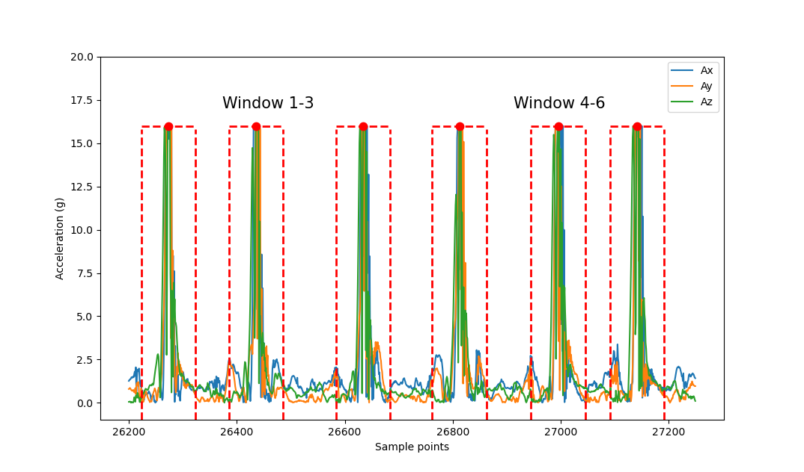

# Badminton Stroke Recognition with a Racket-Mounted IMU Device

A wearable IMU system that recognizes badminton strokes, with and without shuttle contact, using classical machine learning and convolutional neural networks. Recordings from a racket-mounted IMU are filtered, segmented into individual strokes, and classified into 8 classes.

This repository accompanies my B.Eng. thesis, *Classification of Badminton Strokes Using Motion Sensor Technology and Machine Learning Techniques* (International University, Vietnam National University Ho Chi Minh City, 2024), advised by Dr. Huynh Tan Quoc.

📄 **[Read the full thesis](docs/Thesis.pdf)**

**Highlights**

- 9,784 labeled strokes from 5 players across 8 classes
- 97.43% test accuracy with an RBF SVM on 122 handcrafted features, and 97.87% with a CNN on raw IMU signals
- Classical and deep learning approaches compared on the same split, with per-class error analysis

**Related project:** [IMU-Badminton-Data-Collection-System](https://github.com/PhusNguyen/IMU-Badminton-Data-Collection-System) contains the hardware, firmware, and server used to collect this dataset.

---

## Repository structure

```
.
├── dataset/          # Labeled stroke dataset (JSON)
├── ClassicalML/      # Feature extraction, scaling, PCA, RF / KNN / SVM
│   └── models/
│       └── svm_model.pkl
├── DeepLearning/     # CNN architectures and training
│   └── models/
│       └── dl_optimize.pth
├── docs/
│   ├── Thesis.pdf
│   └── images/
├── realtime_classicalML.py   # Live inference with the SVM
├── realtime_DL.py            # Live inference with the CNN
└── README.md
```

## Pipeline



**Noise reduction.** A Gaussian filter (σ = 5) smooths the accelerometer RMS signal before peak detection. In the classical pipeline, each stroke window is also smoothed (σ = 0.5) before features are extracted.

**Segmentation.** Each stroke is isolated in three steps:

1. Compute the accelerometer RMS across the three axes at every sample, then smooth it.
2. Find each region where the smoothed RMS exceeds a threshold, and take its midpoint as the stroke center. Centers closer than 50 samples are merged.
3. Take 50 samples before and after each center, giving a 100-sample (1 s) window centered on the stroke.

<p align="center">
  
</p>

---

## Dataset

Five players of different skill levels and playing styles performed four backcourt strokes, each in two variants:

- **Real:** played in an actual rally with the shuttle
- **Fake:** the same motion performed without a shuttle or opponent

Each player performed each stroke 100 times in a row before switching.

| Label | Class | Samples |
| ---: | --- | ---: |
| 1 | Clear fake | 1,167 |
| 2 | Slice fake | 1,162 |
| 3 | Drive fake | 1,189 |
| 4 | Smash fake | 1,171 |
| 5 | Clear real | 1,191 |
| 6 | Slice real | 1,217 |
| 7 | Drive real | 1,304 |
| 8 | Smash real | 1,283 |
| | **Total** | **9,784** |

The data is split 60% training, 20% validation, and 20% testing.

**Format.** Each sample in `dataset/` contains a `sample_id`, a `stroke_type` (for example `Smash_real`), a numeric `label`, six 100-sample IMU sequences (`AccX`, `AccY`, `AccZ`, `GyX`, `GyY`, `GyZ`), and the 122 precomputed features.

---

## Methods

**Classical machine learning.** Eighteen feature types are computed per axis or axis pair, giving 122 features per stroke:

| Group | Features | What they capture |
| --- | --- | --- |
| Amplitude | Max, min, RMS, crest factor | Peak values and signal power |
| Central tendency | Mean, median | Typical signal level |
| Dispersion | Variance, standard deviation, interquartile range, mean absolute deviation | How widely the signal spreads |
| Distribution shape | Skewness, kurtosis | Asymmetry and tailedness of the signal |
| Cross-axis | Covariance, correlation coefficient | Relationships between pairs of axes |
| Frequency domain | Energy, entropy | Spectral power and randomness |
| Physical | Movement intensity, signal magnitude area | Overall motion magnitude and energy expenditure |

Features are standardized with z-scores and reduced to 40 dimensions with PCA, then classified with Random Forest, KNN, and SVM (linear and RBF kernels).

**Deep learning.** Three CNN architectures adapted from prior badminton studies were trained on the raw six-channel windows, with early stopping on the validation set:

| Source | Architecture | Dropout | Batch | Epochs |
| --- | --- | ---: | ---: | ---: |
| Ghosh et al. (2022) | 3 × Conv1D (256, 128, 64 filters), ReLU, dense output | 0.85 | 400 | 150 |
| Mekruksavanich et al. (2023) | Conv block + 3 residual blocks (Conv1D, BatchNorm), global average pooling | 0.7 | 64 | 50 |
| Peralta et al. (2022) | 2 × Conv2D (16, 32 filters) with BatchNorm and dropout, dense 64, dense 8 | 0.3 | 64 | 100 |

---

## Results

All results below are on the held-out test set.

### Overall

| Approach | Model | Test accuracy | Macro F1 |
| --- | --- | ---: | ---: |
| Deep learning | CNN (Peralta et al. architecture) | **97.87%** | **0.98** |
| Deep learning | ResNet (Mekruksavanich et al.) | 97.13% | 0.97 |
| Deep learning | CNN (Ghosh et al.) | 97.01% | 0.97 |
| Classical ML | SVM, RBF kernel, C = 10 | **97.43%** | **0.97** |
| Classical ML | KNN, k = 3 | 95.85% | 0.96 |
| Classical ML | SVM, linear kernel, C = 1 | 94.26% | 0.94 |
| Classical ML | Random Forest | | 0.94 |

The best CNN also trained fastest of the three architectures, at 2.21 s per step versus 5.32 s and 6.63 s.

### Per-class F1

| Model | Clear fake | Slice fake | Drive fake | Smash fake | Clear real | Slice real | Drive real | Smash real |
| --- | ---: | ---: | ---: | ---: | ---: | ---: | ---: | ---: |
| CNN (Peralta et al.) | 1.00 | 1.00 | 0.99 | 1.00 | 0.94 | 0.99 | 0.98 | 0.94 |
| SVM (RBF) | 1.00 | 1.00 | 0.99 | 1.00 | 0.90 | 0.98 | 0.96 | 0.91 |
| KNN | 0.99 | 1.00 | 0.98 | 0.99 | 0.88 | 0.99 | 0.96 | 0.88 |
| Random Forest | 0.99 | 1.00 | 0.99 | 0.99 | 0.82 | 0.98 | 0.93 | 0.84 |
| SVM (linear) | 0.98 | 0.99 | 0.97 | 0.98 | 0.83 | 0.97 | 0.93 | 0.85 |

### Key finding: Clear and Smash are nearly the same motion

Fake strokes are classified almost perfectly. Nearly all remaining errors come from confusing **Clear real** with **Smash real**: 28 of the SVM's errors and 22 of the CNN's. The two strokes use almost the same swing and differ mainly in the angle of the racket face at impact, a subtle difference that a single handle-mounted IMU captures only weakly. The CNN separates them better than any classical model, suggesting that the raw signal holds information the handcrafted features miss.

### Confusion matrices

Rows are actual classes; columns are predicted classes.

<details>
<summary><b>CNN (Peralta et al. architecture)</b></summary>

| Actual \ Predicted | Clear fake | Slice fake | Drive fake | Smash fake | Clear real | Slice real | Drive real | Smash real |
| --- | ---: | ---: | ---: | ---: | ---: | ---: | ---: | ---: |
| Clear fake | **199** | 0 | 0 | 0 | 0 | 0 | 0 | 0 |
| Slice fake | 0 | **214** | 0 | 0 | 0 | 0 | 0 | 0 |
| Drive fake | 0 | 0 | **174** | 0 | 0 | 0 | 0 | 0 |
| Smash fake | 1 | 0 | 0 | **185** | 0 | 0 | 0 | 0 |
| Clear real | 1 | 0 | 0 | 0 | **197** | 0 | 2 | 10 |
| Slice real | 0 | 0 | 1 | 0 | 1 | **224** | 2 | 0 |
| Drive real | 0 | 0 | 1 | 0 | 2 | 0 | **205** | 1 |
| Smash real | 0 | 0 | 0 | 0 | 12 | 1 | 1 | **207** |

</details>

<details>
<summary><b>SVM, RBF kernel</b></summary>

| Actual \ Predicted | Clear fake | Slice fake | Drive fake | Smash fake | Clear real | Slice real | Drive real | Smash real |
| --- | ---: | ---: | ---: | ---: | ---: | ---: | ---: | ---: |
| Clear fake | **199** | 0 | 0 | 0 | 0 | 0 | 0 | 0 |
| Slice fake | 0 | **214** | 0 | 0 | 0 | 0 | 0 | 0 |
| Drive fake | 0 | 0 | **173** | 0 | 0 | 0 | 1 | 0 |
| Smash fake | 0 | 0 | 0 | **186** | 0 | 0 | 0 | 0 |
| Clear real | 1 | 0 | 0 | 0 | **193** | 0 | 2 | 13 |
| Slice real | 0 | 0 | 0 | 0 | 1 | **225** | 2 | 0 |
| Drive real | 0 | 0 | 1 | 0 | 3 | 1 | **204** | 0 |
| Smash real | 0 | 0 | 0 | 0 | 15 | 1 | 1 | **204** |

</details>

### Hyperparameter sweeps

<details>
<summary>KNN, SVM, and Random Forest tuning</summary>

**KNN**, accuracy by number of neighbors:

| k | 1 | 2 | 3 | 4 | 5 |
| --- | ---: | ---: | ---: | ---: | ---: |
| Accuracy (%) | 95.60 | 94.93 | **95.85** | 95.36 | 95.79 |

**SVM**, accuracy by regularization parameter C:

| Kernel | C = 1 | C = 10 | C = 100 | C = 1000 |
| --- | ---: | ---: | ---: | ---: |
| RBF | 96.64 | **97.43** | 97.07 | 97.13 |
| Linear | **94.26** | 93.59 | 93.65 | 93.59 |

**Random Forest.** `n_estimators` was swept from 1 to 500 and `max_depth` from 1 to 100, with `max_features` = 6 (the rounded square root of the PCA dimension). Accuracy rises quickly and plateaus near 95% beyond roughly 50 trees and a depth of about 20.

</details>

---

## Getting started

**Requirements:** Python <!-- TODO: version --> and the packages in `requirements.txt`.

```bash
git clone https://github.com/PhusNguyen/Realtime-IMU-Badminton-Stroke-Recognition.git
cd Realtime-IMU-Badminton-Stroke-Recognition
pip install -r requirements.txt
```

**Reproduce the results**

| Result | Run |
| --- | --- |
| Classical models (RF, KNN, SVM) and sweeps | `ClassicalML/<!-- TODO: notebook or script -->` |
| CNN architectures | `DeepLearning/<!-- TODO: notebook or script -->` |

Results may vary slightly between runs because of random initialization and data shuffling. <!-- TODO: if you fix random seeds, state the seed here -->

## Real-time inference

Two scripts run a trained model on live data from the racket sensor built with [IMU-Badminton-Data-Collection-System](https://github.com/PhusNguyen/IMU-Badminton-Data-Collection-System).

| Script | Model | Model file |
| --- | --- | --- |
| `realtime_classicalML.py` | SVM on 122 handcrafted features, with standardization and PCA | `ClassicalML/models/svm_model.pkl` |
| `realtime_DL.py` | CNN (PyTorch) on raw 6-channel windows | `DeepLearning/models/dl_optimize.pth` |

**How a session works**

1. The script listens for UDP packets on port 44444. Each 240-byte packet holds 10 samples of six big-endian float32 values (AccX, AccY, AccZ, GyX, GyY, GyZ).
2. A live plot shows the incoming signals. Perform your strokes, then close the plot window to end the session.
3. The session is saved, segmented into strokes, and classified. The script prints the number of strokes detected and the predicted class for each, numbered 1 to 8 as in the [dataset table](#dataset).

```bash
python realtime_classicalML.py   # or: python realtime_DL.py
```

Make sure the sensor is on the same network and sending to this computer's IP address. Session files are written to `newdata_prediction/`, which is cleared at the start of every run.

## Citation

```bibtex
@thesis{nguyen2024badminton,
  author = {Nguyen, Le Anh Phu},
  title  = {Classification of Badminton Strokes Using Motion Sensor Technology and Machine Learning Techniques},
  type   = {B.Eng. thesis},
  school = {International University, Vietnam National University Ho Chi Minh City},
  year   = {2024}
}
```

## License

Released under the [MIT License](LICENSE).
